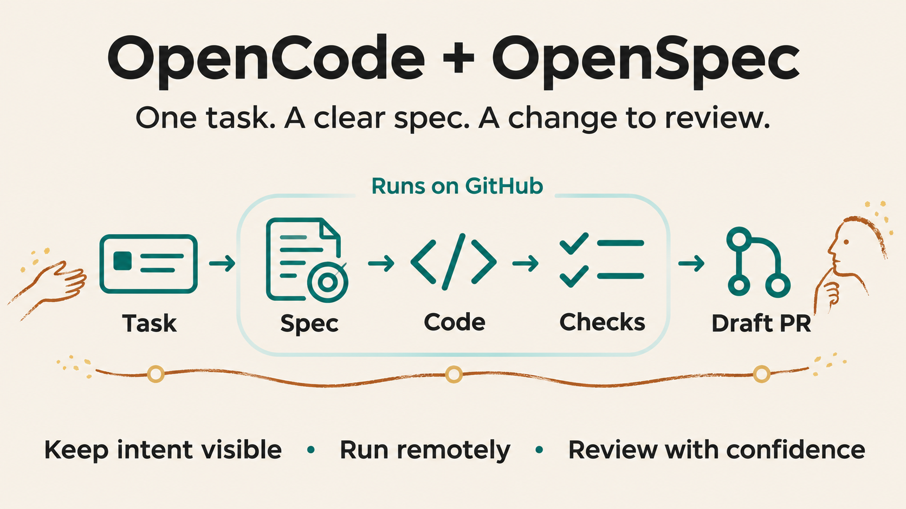

# ASF Agent Kits

**Portable agent workflows for your GitHub repository. Start with one task, keep a written spec, and review the result in a pull request.**

ASF Agent Kits packages coding workflows that you can install and version in your own repository. The first published kit, OpenCode + OpenSpec, runs an agent on GitHub Actions and turns a backlog task into a draft pull request.

## Why use it?

Coding agents can move fast while losing sight of the original request. A written spec gives the work a stable reference. A defined workflow adds checks, traceable changes and clear review points.

OpenSpec structures the goal, design, requirements and implementation steps. OpenCode writes the change. GitHub runs the workflow remotely. Your tests, independent CI and human review check the result.

The illustration shows the published OpenCode + OpenSpec path. The catalogue can hold other workflows.

## Choose a kit

| Kit | Status | Use |
| --- | --- | --- |
| OpenCode + OpenSpec | Published: 1.1.0 | Work from a spec, implement, check and review |
| OpenCode Direct | Planned profile; no executable release | Intended for direct agent work without the full OpenSpec cycle |

Start with [Overview](docs/kits/opencode-openspec/overview.md). See [Overview and availability](docs/kits/opencode-direct/overview.md) for the second profile.

## Get started

You need an existing Node.js project with a lockfile, tests, OpenSpec context, a task backlog and GitHub Actions.

1. [Install](docs/kits/opencode-openspec/install.md) - preview the files, install on a branch and review the installation PR.
2. [GitHub setup](docs/kits/opencode-openspec/github-setup.md) - set up the App, provider key and project protection.
3. [Run a task](docs/kits/opencode-openspec/use.md) - run plan for one small task, review the spec, then run apply.

Setup needs project values and GitHub settings, so there is no complete one-line install today. Local installation uses Linux or WSL2. Agent execution runs remotely on GitHub.

## How OpenCode + OpenSpec works

**Plan → apply → sync specs**, with checks between steps.

Plan writes the proposal, design, requirements and task list. Apply writes code and tests from that plan. Finalize syncs shared specs and archives the change.

Use separate phase runs when you want to review the plan before implementation. Auto runs the sequence in one dispatch, without a human pause between phases.

These are separate agent invocations with distinct roles. They run in sequence. Auto uses one selected model throughout; separate phase runs can select different allowed models.

The workflow checks scope, OpenSpec format, task completion and project tests. The published PR then goes through independent CI and human review. These checks help keep intent visible; they cannot guarantee the solution meets every user need.

## Know before you run

- Run one task at a time. This kit has no task-wave scheduler.
- OpenCode runs on GitHub compute, away from your workstation. The publishing token is kept out of the model execution job. Remote execution still has network and provider-key risks.
- The current model list uses OpenRouter and does not include OpenAI models.
- Auto can invoke three agent phases. Each may make several API requests. There is no dollar cap.
- The workflow opens or updates a draft PR. It does not automatically retry paid work or merge changes.
- The current actor check supports a personal repository owner; organization use requires a reviewed policy change.

Read [Limits, isolation and costs](docs/kits/opencode-openspec/limits.md) before the first run.

## Explore the documentation

[Architecture](docs/kits/opencode-openspec/architecture.md) · [Update and rollback](docs/kits/opencode-openspec/update.md) · [Troubleshooting](docs/kits/opencode-openspec/troubleshooting.md) · [Reference](docs/kits/opencode-openspec/reference.md) · [Releases and evidence](docs/kits/opencode-openspec/releases.md)

## What comes next?

The catalogue is designed to host more independently versioned workflows. Future kits may coordinate several project tasks or run task waves. Those features are not part of the current published kit.

## Release

Use [opencode-openspec 1.1.0](https://github.com/cedricmenec/asf-agent-kits/releases/tag/kits/opencode-openspec/v1.1.0). Each installed kit records its source commit and file hashes. The local lock does not authenticate the release publisher.
