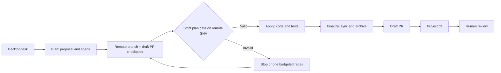
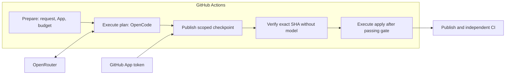

# Architecture

GitHub Actions controls the order. OpenCode performs the agent work. OpenSpec stores the intent and change history. Your own CI checks the published result.

## Functional flow

Both staged and auto modes publish the plan before `apply`. The quality gate checks that exact remote SHA. In auto, an invalid plan blocks `apply`; with an explicitly budgeted single repair, it can return to the checkpoint and be checked again. A failed gate leaves the already-safe plan accessible for review, not an approved implementation.

## Separate execution, verification and publication roles

Prepare checks the actor, repository, branch, first attempt, task, phase, model and project prerequisites. It mints a short-lived GitHub App token with required `contents`/`pull-requests` write permissions and probes repository access **before** the first model execution. Optional repair also needs a valid bounded provider-key budget at prepare time.

Each execution starts a separate Ubuntu runner, reads guard scripts from the trusted dispatch commit, selects the *exact* observed work branch tip and installs fixed OpenCode and OpenSpec versions. It receives the provider key. It does not receive the App publication token. Each paid execution uses the configured concurrency group.

Each publish runs on another runner. It checks that the default and work branch refs have not moved, checks the patch and scope, then mints an App token to push an ordinary branch and create or update a draft PR. No force-push or protected ref write is allowed. After plan publication, a separate no-model job checks the remote SHA using the OpenSpec strict validator, checklist contract and project's configured `npm run` check. A second exact-tip check prevents stale apply or repair.

## Separate agent roles

Plan and apply use separate OpenCode run invocations with different prompts. Finalize invokes OPSX sync. These are sequential role-specific calls. The kit does not launch a parallel team of sub-agents.

Auto uses one model selected for the whole run. Separate staged dispatches can choose different allowed models.

## Deterministic checks

The scripts enforce task and model selection, branch observations, path rules, checklist format and OpenSpec validation. The project check command tests product behavior. Independent CI checks the PR commit separately from the agent job.

These checks enforce defined rules. They do not prove that a spec is the right solution or that agent-written tests cover every important behavior.

## Files and state

The task and OpenSpec config are project inputs. Changes live under openspec/changes/\<task-id>/. Shared specs live under openspec/specs/. Archives live under openspec/changes/archive/.

The work branch and draft PR carry a durable intermediate plan checkpoint and the eventual code/archived specs. This is not a general recovery engine; a manual `apply` dispatch can reuse a validated existing plan. The workflow emits phase checkpoint SHA and quality result in GitHub summaries.

## Runtime baseline

The proposed template pins OpenCode 1.19.0, OpenSpec 1.14.1 and Node.js 26.13.0 on ubuntu-24.04. GitHub Actions are pinned to commits. Pinning supports repeatability; review updates as dependencies change. These changes are not part of already published 1.4.0 tags.

## Continue

[Limits, isolation and costs](limits.md) · [Reference](reference.md) · [Documentation index](../../README.md)
