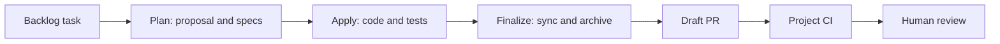
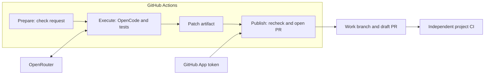

# Architecture

GitHub Actions controls the order. OpenCode performs the agent work. OpenSpec stores the intent and change history. Your own CI checks the published result.

## Functional flow

In staged mode, plan and apply each publish to the same work branch. In auto mode, intermediate work stays in the execution job and one final patch is published after the sequence succeeds.

## Three jobs with separate roles

Prepare checks the actor, repository, branch, first attempt, task, phase and model. It observes the work branch tip.

Execute starts a separate Ubuntu runner, reads guard scripts from the dispatch commit, selects the observed work branch and installs fixed OpenCode and OpenSpec versions. It receives the provider key. It does not receive the App publication token.

Publish runs on another runner. It checks that the default and work branch refs have not moved, checks the patch and scope, then creates a short-lived App token to push an ordinary branch and create or update a draft PR.

## Separate agent roles

Plan and apply use separate OpenCode run invocations with different prompts. Finalize invokes OPSX sync. These are sequential role-specific calls. The kit does not launch a parallel team of sub-agents.

Auto uses one model selected for the whole run. Separate staged dispatches can choose different allowed models.

## Deterministic checks

The scripts enforce task and model selection, branch observations, path rules, checklist format and OpenSpec validation. The project check command tests product behavior. Independent CI checks the PR commit separately from the agent job.

These checks enforce defined rules. They do not prove that a spec is the right solution or that agent-written tests cover every important behavior.

## Files and state

The task and OpenSpec config are project inputs. Changes live under openspec/changes/\<task-id>/. Shared specs live under openspec/specs/. Archives live under openspec/changes/archive/.

The work branch and PR carry state between staged runs. The kit has no general durable checkpoint or automatic recovery engine.

## Runtime baseline

The published template pins OpenCode 1.19.0, OpenSpec 1.14.1 and Node.js 22.23.3 on ubuntu-24.04. GitHub Actions are pinned to commits. Pinning supports repeatability; review updates as dependencies change.

## Continue

[Limits, isolation and costs](limits.md) · [Reference](reference.md) · [Documentation index](../../README.md)
