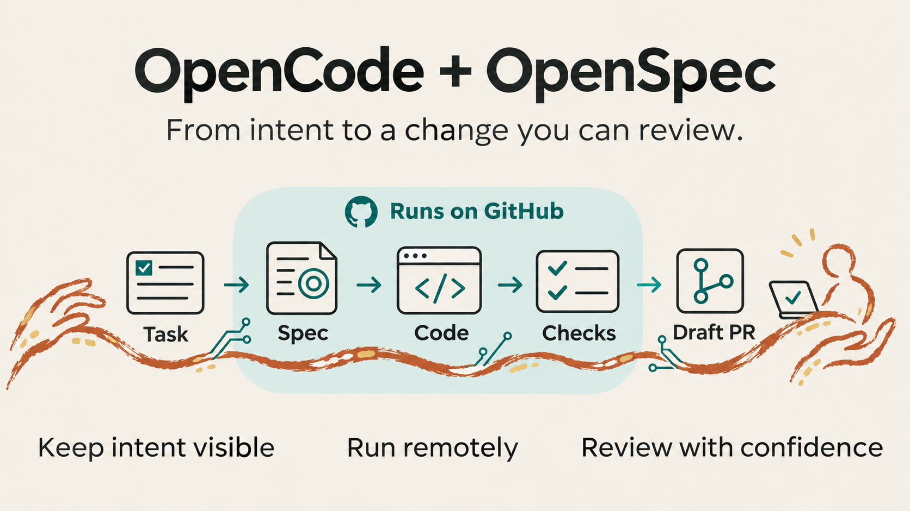
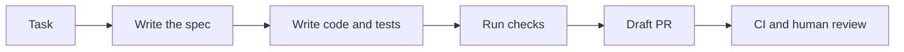

# Overview

Turn one clear task into a change you can review.

OpenSpec records the goal, design, requirements and implementation steps. OpenCode makes the changes on a GitHub Actions runner. The workflow checks the result and opens a draft pull request (PR). Your project CI and a human review decide whether it is ready.

## When to use it

Use this kit when you want an agent to work from a written plan, leave a clear record of changes, and run on GitHub instead of your own computer. It fits an existing Node.js project with tests, a backlog and GitHub Actions.

It helps with three common problems: unclear requests, code that drifts from the requested change, and agent work that is hard to review. The written plan, scope checks and tests reduce these problems. They cannot prove that the product meets every user need.

## What you get

- A versioned workflow installed in your repository.
- Separate plan, implementation and spec update steps.
- A work branch, a draft PR and independent CI.
- A lock file that records the source commit and installed file hashes.

The published kit is opencode-openspec 1.1.0. OpenCode Direct is a separate design profile with no executable release in this repository.

## The flow

Choose staged runs to review the plan before implementation. In the proposed checkpoint workflow, auto publishes the plan as a draft PR, verifies its exact remote SHA, and only then proceeds to apply and spec sync. Auto has no human stop after a passing gate, but it blocks an invalid plan. At most one additional repair invocation may be enabled under a separately bounded budget.

## Keep intent over time

The task captures the request. The OpenSpec proposal, design and delta specs make it concrete. Apply uses those documents. Finalize syncs the change into the shared specs and archives the change. This creates a record that future work can read.

Spec sync uses an agent. Review its meaning as well as its format. Passing validation does not prove that every requirement was preserved.

## Scope

The current kit handles one named task per dispatch. It does not select a backlog, run task waves, manage several repositories or merge PRs. Future kits may add these workflows.

## Guides

Start: [Install](install.md) → [GitHub setup](github-setup.md) → [Run a task](use.md).

Details: [Architecture](architecture.md) · [Limits, isolation and costs](limits.md) · [Reference](reference.md).

Maintain: [Update and rollback](update.md) · [Troubleshooting](troubleshooting.md) · [Releases and evidence](releases.md).
